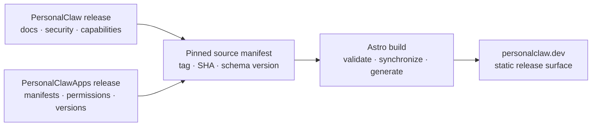

<p align="center">
  
</p>

<h1 align="center">personalclaw.dev</h1>

<p align="center">
  <strong>The public product, documentation, security, installation, and ecosystem surface for PersonalClaw.</strong>
</p>

<p align="center">
  <a href="https://github.com/PersonalClaw/personalclaw.dev/actions/workflows/ci.yml">
    
  </a>
</p>

<p align="center">
  <a href="https://personalclaw.dev">Website</a>
  ·
  <a href="https://github.com/PersonalClaw/PersonalClaw">Core</a>
  ·
  <a href="https://github.com/PersonalClaw/PersonalClawApps">First-party apps</a>
</p>


## What This Repository Is

This repository contains the source for [personalclaw.dev](https://personalclaw.dev), the public release interface for PersonalClaw.

It has a broader job than a conventional marketing site:

- Show the real product through real, reproducible captures.
- Explain how chat, goal loops, memory, knowledge, automation, and apps fit together.
- Make the ownership, trust, and permission boundaries understandable.
- Publish documentation and installation paths tied to verifiable releases.
- Represent the first-party app ecosystem without duplicating its source of truth.
- Help operators and builders evaluate the project without tracking them.

The website should be persuasive because it is specific and checkable, not because it hides the product's maturity or tradeoffs.

> [!IMPORTANT]
> The source manifest is on the `released` channel: it pins the exact core and apps commits of a **tagged** release, and the site identifies itself as a verified release of that version. The website's own `package.json` version tracks the core release it publishes, and that agreement is enforced mechanically — see [Release parity](#release-parity) and [docs/release-runbook.md](./docs/release-runbook.md). The production `/install` contract remains roadmap work.

## Experience Map

| Route | Purpose |
|---|---|
| `/` | Product thesis, system overview, ecosystem proof, security posture, and source quickstart |
| `/product` | Guided tour of chat, autonomous goals, memory, knowledge, automation, and agent runtimes |
| `/apps` | Searchable first-party app directory and app-platform explanation |
| `/security` | Trust boundaries, enforced controls, supply-chain lifecycle, and known limitations |
| `/release` | Build channel, exact source commits, package/changelog facts, and manifest-derived ecosystem evidence |
| `/blog` | Posts written here, each naming the release its claims were verified against |
| `/compare` | Row-by-row account of what PersonalClaw does and does not do at the released version, each row sourced to a file at the tag |
| `/docs` | Documentation landing: three routes through the corpus (running it, extending it, trusting it), over a generated list of sections |
| `/docs/{guides,reference,architecture,security,research}` | One section index per tree — committed prose over a generated page list — and every document the pinned release publishes beneath it |

The `/docs` tier is generated from the pinned core commit, so its **shape** is contracted
here and its **words** are not. `/docs/reference` doubles as the API documentation space:
the gateway's HTTP, WebSocket and MCP surfaces are documented in core's reference tree, and
a second landing page for them would be a second place to describe one API.

The next major public surfaces are synchronized documentation, release provenance, stable installation, changelog, and app detail routes.

## Product Principles

### Show the product

Product captures carry the argument. The site does not use fabricated dashboards, generic AI illustrations, or abstract decoration where an actual interface can explain the capability.

### Publish release truth

Production copy must describe tagged, reproducibly released behavior. Product capabilities, version numbers, security controls, platform support, app metadata, and install methods should be generated or synchronized from their owning repositories.

### Name the boundary

Security language distinguishes enforced controls, work in progress, and documented limitations. Planned hardening is never presented as an existing guarantee.

### Respect the visitor

Zero telemetry is part of the product position. The site has no visitor analytics, session replay, fingerprinting, conversion events, or tracking pixels. Astro's own telemetry is disabled in every repository script.

### Design for inspection

The interface targets WCAG 2.2 AA, keyboard access, 44px touch targets, reduced-motion support, stable responsive media, and readable technical content.

## Technical Architecture

The site is a static Astro application with small React islands only where client-side state is useful.

- **Astro 7** for routing, static rendering, metadata, and responsive image generation.
- **React 19** for the interactive system window, app search, and command copying.
- **TypeScript** across application and component code.
- **Lucide** for interface iconography.
- **Local variable fonts** through Fontsource; no runtime font dependency.
- **Plain CSS and design tokens** for the visual system; no utility framework or component runtime.
- **Playwright Test and Axe** for responsive behavior, accessibility, privacy, keyboard, and visual regression.
- **Lighthouse** for mobile-simulated performance, accessibility, best-practice, SEO, and transfer budgets.



This source flow is active. `sources/personalclaw.sources.json` pins full commits, `scripts/sync-sources.mjs` validates and reads only those revisions, and the ignored `.generated/release-facts.json` artifact feeds the site build. The app directory's descriptions remain curated in `src/data/apps.ts`, but its names and categories are checked against every pinned app manifest so drift fails the build.

## Design Direction

The creative north star is **The Friendly Machine, Seen at Work**.

PersonalClaw is presented as a capable machine working beside one owner in a quiet night studio. Near-black surfaces establish the environment; coral marks action, focus, and active intelligence. The visual system stays warm without becoming ornamental and technical without falling into terminal cosplay.

The complete rationale, token system, interaction rules, responsive behavior, and content voice live in:

- [PRODUCT.md](./PRODUCT.md) for audience, positioning, proof, and product language.
- [DESIGN.md](./DESIGN.md) for visual direction, layout, typography, motion, and component rules.

When implementation and those documents disagree, treat the disagreement as a design decision to resolve, not permission for silent drift.

## Getting Started

### Prerequisites

- Node.js `22.23.3` (the exact CI runtime in `.node-version`; the locked dependencies need 22.19 or newer)
- npm `10.9.9` (the `packageManager` in `package.json`, bundled with that Node release)
- [mise](https://mise.jdx.dev/) recommended for automatic runtime selection

### Local Development

```bash
git clone https://github.com/PersonalClaw/personalclaw.dev.git
cd personalclaw.dev
npm ci
npm run hooks:install
npm run dev
```

Astro serves the site at [http://localhost:4321](http://localhost:4321) by default.

Source synchronization first looks for exact matching sibling checkouts at `../PersonalClaw` and `../PersonalClawApps`. If either checkout is absent, points at another origin, or has a different HEAD, the synchronizer verifies the pinned commit with GitHub and fetches only the required files. `PERSONALCLAW_CORE_DIR` and `PERSONALCLAW_APPS_DIR` can provide explicit checkout paths; explicit mismatches fail instead of falling back.

### Production Build

```bash
npm run build
npm run preview
```

The build runs Astro diagnostics before producing the static site in `dist/`.

## Commands

| Command | What it does |
|---|---|
| `npm run sync:sources` | Validates source pins, generates ignored release facts from exact revisions, and writes `public/install` from the pinned core installer with its digest |
| `npm run check:served-installer` | Checks the installer served at `/install` against `public/install`, the newest core release's installer and its checksums (run daily by **Release follow**) |
| `npm run sync:registry` | Reads the community app registry, and one README per listing, from the registry repository at its pinned commit, once the pinned core release lists it in its Store |
| `npm run dev` | Starts the local Astro development server |
| `npm run check` | Runs Astro and TypeScript diagnostics |
| `npm run build` | Runs diagnostics and creates the production static build |
| `npm run preview` | Serves the production build locally |
| `npm run validate:release-parity` | Checks the website version against the pinned + newest published core release (see [Release parity](#release-parity)) |
| `npm run validate:registry` | Rebuilds `/registry` against fixture registries that carry listings and asserts what it renders |
| `npm run validate:blog` | Asserts `/blog` renders one listing item per readable post, and that each post is published, contracted, and not an empty body |
| `npm run validate:compare` | Refuses a `/compare` matrix that renders no rows, drifts from its data, sources a row to a branch instead of the pinned release, or stops carrying the rows that do not hold |
| `npm run validate:source-pins` | Refuses any hand-authored link into core, apps or the registry at a moving ref (`main`, `master`, `HEAD`, `latest`) — the same release-not-branch rule `validate:compare` applies to matrix rows, applied to page copy |
| `npm run test:static` | Validates production and preview publication artifacts; with `-- --prebuilt`, tests a shared build instead of making one (see [One build per CI run](#one-build-per-ci-run)) |
| `npm run build:preview:site` | Makes the noindex preview build into `.preview-dist/` from the current sync, without syncing again |
| `npm run build:record` / `npm run verify:build-record` | Writes, or verifies, `.generated/build-record.json` for the shared CI build |
| `npm run test:browser` | Builds and runs the complete Playwright suite |
| `npm run test:browser:prebuilt` | Verifies the shared build's record, then runs the Playwright suite against it (CI) |
| `npm run test:lighthouse` | Builds and enforces Lighthouse budgets on every route |
| `npm run test:lighthouse:prebuilt` | Verifies the shared build's record, then enforces the Lighthouse budgets against it (CI) |
| `npm run test:ci` | Runs the same aggregate quality floor used by CI |
| `npm run test:prepush` | Installs the lockfile and runs the aggregate gate under the exact CI Node runtime |
| `npm run test:visual:update` | Deliberately refreshes committed visual baselines |
| `npm run hooks:install` | Enables the repository-owned pre-push hook |

All scripts set `ASTRO_TELEMETRY_DISABLED=1`.

## Quality Floor

The route contract in `tests/support/site-contract.mjs` is shared by static, browser, and performance gates. A new hand-authored page fails validation until it is added to that contract and receives the same coverage as every existing route.

The `/docs` route set is the exception, and deliberately so: it is **derived** from
`.generated/docs-index.json`, which `scripts/sync-docs.mjs` writes from the pinned core
commit. The published corpus is a function of which release the site pins, so advancing the
pin to a release carrying new documentation publishes it with no code change here — and
under the hand-written allow list this replaced, the same pin advance published nothing.
`scripts/validate-build.mjs` still asserts set equality in both directions; what it compares
is the sync's manifest against the pages the build generated, so a document the sync wrote
that Starlight did not publish, or a page Starlight published that the sync did not write,
still fails loudly. Two floors guard the content: `assertPublishable()` in
`scripts/docs-publication.mjs` refuses a stub while the sync is still reading source, and
`DOCS_BODY_TEXT_FLOOR` refuses a page that renders nearly empty. A 200 over a blank page is
worse than a 404, because nothing reports it.

Three tiers are contracted differently, and the contract says why in place: the generated
`/docs` corpus (core owns its words), the community **registry** tier, and the **blog**
tier. `/registry` is
held to the metadata, runtime, accessibility and Lighthouse contracts like every other
route, but carries **no pixel baseline** — it renders a registry owned by another
repository, so a committed screenshot would be invalidated by a registry pull request
rather than by a change here. What replaces the baseline is `npm run validate:registry`,
which rebuilds the page against fixture registries that carry listings. That check exists
because the production registry is empty — a listing surface built against it renders
nothing, looks clean, and passes every other gate vacuously.

`/blog` carries no pixel baseline either, for a different reason: a post's page height is a
function of prose length and the listing's height is a function of post count, so a
committed screenshot there would be refreshed by publishing writing rather than by changing
a design — on two platforms, one of which only CI can regenerate. Its design is pixel-locked
where it lives, in the shared shell and card treatment the five marketing routes already
baseline. Everything else applies, and `npm run validate:blog` replaces the screenshot with
the assertion a screenshot would have made: a collection with readable posts must not
render an empty listing.

The required checks are below. On CI all three test one shared build, made once per run by the `build` job (see [One build per CI run](#one-build-per-ci-run)); a failed build turns all three red.

- **Static publication contract:** Astro and TypeScript diagnostics, exact route inventory, internal links and fragments, local runtime assets, and the *universal head contract* below, plus sitemap completeness, robots policy, the `llms.txt` pair, tracker signatures, preview `noindex`, and Vercel output/trailing-slash/security-header configuration.

The head contract is **derived from the build output, not from a list of routes**, which is what makes it the anti-regression mechanism rather than a second inventory. Every generated page — a marketing route, a synced `/docs` topic, a per-listing registry page, one a branch adds tomorrow — must carry a title naming the site, a description, a correct absolute `rel=canonical`, exactly one `robots` tag with the right policy, a complete Open Graph and Twitter card (image, real dimensions, alt text), and exactly one parseable JSON-LD graph whose `WebPage` matches the page's own title, description and canonical. Breadcrumb `item` URLs are resolved against the build, so a crumb pointing at a route that does not exist fails. The social card's declared dimensions are measured against the PNG rather than compared with a second copy of the numbers, and the sweep carries a coverage floor so it cannot pass by measuring nothing. What each tier contracts *on top* of this stays in its own block: exact title and description strings for pages written here, a rendered-body floor for the pages core owns.
- **Browser contract:** every route under desktop, mobile, and reduced-motion projects; Axe WCAG A/AA scans; keyboard-only critical journeys; app query/category URL state; tab behavior; command copy; focus-safe mobile navigation; image loading; horizontal overflow; 44px targets; console/page/request failures; no words glued together on any built page, desktop or mobile (`compressHTML` drops a newline before an inline element or `{...}` expression, so a source line that reads correctly can ship as `inv0.1.3`; end such a line with `{" "}`); and a same-origin-only network assertion through meaningful interaction states.
- **Visual contract:** committed full-page desktop and mobile baselines for every route plus loop, app-filter, and mobile-menu states.
- **Performance contract:** Lighthouse scores of at least 90 performance and 95 accessibility/best-practices/SEO, with LCP at most 2.5s, CLS at most 0.1, TBT at most 200ms, and explicit page, script, font, and image transfer budgets.

Install the repository's Chromium build once, then run all gates:

```bash
npx playwright install chromium
npm run hooks:install
npm run test:prepush
```

Playwright HTML reports, traces, videos, screenshots from failed tests, and Lighthouse reports are generated locally but ignored. The reviewed visual baselines under `tests/browser/__screenshots__/` are source-controlled.

GitHub Actions exposes three stable jobs that can be required by branch protection: `static-contract`, `browser`, and `performance`. Dependabot checks npm and action updates weekly.

### One build per CI run

CI builds the site once. The `build` job ("Build the site once for every check") runs `npm run build`, then the preview build from the same source sync (`npm run build:preview:site`, so `.generated/` still describes `dist/`), requires a clean tree, and writes `.generated/build-record.json` (`npm run build:record`). It uploads one `site-build` artifact: `dist/`, `.preview-dist/`, `.generated/`, the synced `src/content/docs/` and the `llms.txt` pair. `build` is not a required check, and `release-parity` does not wait for it.

The record names the commit and tree the build came from, the run that made it, the exact Node and npm, the lock's digest, the source pins, the digest and `generatedAt` of each generated data file, and every artifact file with its size and sha256, under one digest. The upload's own digest is logged by each check, and the download fails on a mismatch.

The three required jobs test that one build:

- Each declares `needs: build` and runs with `if: always()`. Its first step after the runner identity fails with "build failed, nothing checked" when `build` did not succeed, or with "the build was cancelled, nothing checked" when a newer run cancelled it. A job skipped because a dependency failed reports success, so without this a required check would pass a broken build; a cancelled build is red for the same reason, and only its message differs.
- After downloading the artifact, `node scripts/build-record.mjs verify` refuses a build that is missing, from another run, from another tree or a changed checkout, made with another Node or npm or other pins, or changed since it was recorded (a file changed, missing or added, or generated data re-synced), and names which.
- `static-contract` runs `npm run test:static -- --prebuilt`, which verifies the record in place of the `build` and `build:preview` gates and runs every other gate as before. `browser` and `performance` run `npm run test:browser:prebuilt` and `npm run test:lighthouse:prebuilt`. None of them builds or syncs. The registry render check still makes its two fixture builds, on purpose.

`tests/support/ci-contract.mjs` holds that shape (rule `shared-build`): the three job names, `needs: build`, `if: always()`, the gate step, the download, the verify, no rebuild in a required job, and a `build` job with a timeout, a record and an upload that keeps hidden files. Locally, `test:browser`, `test:lighthouse`, `test:ci` and the pre-push gate still build for themselves.

### Supply chain

What CI runs is pinned, and every job holds only the token permissions it needs. `tests/supply-chain.test.mjs` holds that over `.github/workflows/*.yml`, every `package.json` CI installs from, any Dockerfile, and `.github/supply-chain.toml`. It runs in `npm run test:unit` and in the unit tier of `npm run test:static`, so the **Static build and publication contract** job fails on a broken pin. `tests/ci-contract.test.mjs` holds the runner rules beside it, and both read the workflows through one YAML reader, `tests/support/workflows.mjs`.

How to pin:

- **Actions** by full commit SHA, with the release tag as a comment: `uses: actions/checkout@<40-hex sha> # v7.0.1`. A `docker://` action is an image, below.
- **Images** by digest for one platform: a workflow `container:` or `services:` image as `name@sha256:<digest> # linux/amd64`, and a Dockerfile `FROM` with `--platform=` or a `# linux/<arch>` comment on the line above. An image named through an `ARG` is judged by the `ARG`'s default.
- **Tools** a `run:` step installs name an exact version, or install from the lock (`npm ci`, or `npx` of a binary a locked direct dependency provides). `npx playwright install --with-deps chromium` counts as installing from the lock: the locked Playwright fixes the browser build. The apt packages `--with-deps` adds come from the runner image, which each job's **Record runner identity** step records.
- **Setup actions** read `.node-version` (setup-node) or an exact `x.y.z`, and never set `check-latest`.
- **Node** is an exact release in `.node-version`, on a line `.github/supply-chain.toml`'s `node_end_of_life` table lists and that has not reached its date, at or above every locked package's `engines.node`, and inside `package.json` `engines`. Each `package.json` CI installs from has an exact `packageManager`.

Least privilege:

- Every job declares `permissions:`, on the job or at the top of the workflow, and none holds `write-all`. A write grant at the top that no job inherits fails too: it would reach the next job added.
- Every write permission a job holds, and every `actions/checkout` that keeps its credentials, is an `[[audited_write]]` entry in `.github/supply-chain.toml`: the workflow, the job, the permission (`issues: write`, or `persist-credentials` for a checkout), the steps that use it, and why. Anything not listed fails, and an entry that matches no grant or step fails. Every checkout sets `persist-credentials: false` today.
- A token (`github.token` or `secrets.*`) goes in the `env:` of the steps that call the API, never in a workflow or job `env:`, which would hand it to `npm ci`'s install scripts too.

How a refresh arrives: Dependabot's weekly `github-actions` update moves a SHA and its tag comment together, with the upstream release notes, and its pull request runs the same CI. A Node line's end-of-life date comes from the [Node.js release schedule](https://github.com/nodejs/Release); add the next line to the table before moving to it.

How to add or renew an exception: add an `[[exception]]` to `.github/supply-chain.toml` with `file` and `reference` (both exactly as the failing check reports them), `scope` (the rule id), `owner = "maintainers"`, `reason`, and `expires`, a date at most 30 days out. Renewing is a new `expires`, at most 30 days from that day, and a new reason. An exception past its date, more than 30 days out, matching nothing, or missing a field fails the check, so an exception cannot outlive its reason unnoticed.

The pre-push hook is a local mirror of those three jobs and is mandatory for this
repository. It starts from `npm ci`, so tests always use the committed lockfile. Do
not use `--no-verify` to bypass it. If a gate is red or cannot run, stop and fix the
gate or its environment before publishing commits. Visual baselines are
platform-qualified for macOS development and Linux CI; update them only after
inspecting the rendered result on the platform that produced it.

## Repository Structure

```text
.
├── .github/             CI workflows, dependency updates and the supply-chain policy
├── public/brand/        Public brand mark and social preview
├── scripts/             Artifact and Lighthouse quality gates
├── sources/             Committed source manifest and JSON Schema
├── src/assets/          Product captures optimized by Astro
├── src/components/      Astro components and focused React islands
├── src/data/            Transitional site and app content
├── src/layouts/         Shared document shell and metadata
├── src/pages/           Route entry points
├── src/prose/           The docs landing and the five section indexes, hand-written here
├── src/styles/          Global styles and design tokens
├── tests/browser/       User, accessibility, privacy, and visual coverage
├── tests/fixtures/      Registry inputs the render check rebuilds against
├── tests/support/       Shared public route contract, workflow reader and CI checks
├── DESIGN.md            Visual and interaction specification
└── PRODUCT.md           Audience, positioning, and product brief
```

## Content And Release Truth

PersonalClaw spans three repositories, with deliberately separate ownership:

| Content | Owning source |
|---|---|
| Product capabilities, version, docs, security posture, and changelog | [PersonalClaw](https://github.com/PersonalClaw/PersonalClaw) |
| First-party app manifests, permissions, requirements, and compatibility | [PersonalClawApps](https://github.com/PersonalClaw/PersonalClawApps) |
| Community app listings, their declared permissions, and their scan verdicts | [registry](https://github.com/PersonalClaw/registry) `app-registry.json`, pinned by commit as `data.registry` |
| The installer served at `/install` | [PersonalClaw](https://github.com/PersonalClaw/PersonalClaw) `deploy/website/install.sh`; `public/install` is generated from the pinned core commit by `npm run sync:sources` and held to it by `validate:release-parity` |
| Presentation, public routing, synchronized docs build, and serving `/install` | This repository |

Every build pins full source SHAs. The manifest supports two fail-closed channels:

- `pre-release` requires both tags to be `null` and renders a pinned development snapshot.
- `released` requires tags for both repositories, verifies that each tag resolves to its declared SHA, and requires the core tag to match the package version.

The registry is pinned beside them under `data`, by commit alone: it is data published continuously, not a release, so it has no tag and takes no part in version parity. Its pin is still held current, because a pin is a frozen copy: see [Release parity](#release-parity).

The manifest is currently on `released`. Generated files and fetched source caches are ignored; copied source content is never committed to this repository.

That rule decides what `/registry` shows. What makes a community listing part of released PersonalClaw is a release whose Store reads the registry, which is a release whose catalog seeds the registry source. For a release that does not, such as v0.1.3, `/registry` says so and the registry is not read, rather than publishing a Store feature that release does not have. From v0.2.0 on, the Store reads it, so the page shows the registry at its pin: today an empty state, because the registry lists no apps at its current commit.

### Claims about our own capabilities

`/compare` is the site's densest concentration of capability claims, so it runs on a
stricter rule than prose elsewhere. It states what PersonalClaw does **and does not** do,
and it is held to the release, not to the branch.

- **Every row cites a file at the pinned release tag, with the ISO date it was read.**
  `npm run validate:compare` fails if a row's link does not point into that tag — a row
  sourced to a branch can be true in development and false in the release a reader can
  actually install. That is not hypothetical: the launch post had to cut ten claim families
  for exactly this reason, one of them a field declared on a policy object with zero
  consumers, which would have shipped an inert control as a security feature.
- **`partial` is a first-class verdict.** Most overclaims are not inventions; they are true
  readings stated wider than the release supports. A two-state matrix forces each of those
  into a `yes` that overstates or a `no` that undersells, and the overstatement is the one
  that gets picked. A `partial` row must write out the narrower truth.
- **The rows that do not hold are the point.** The check fails if the matrix stops carrying
  `no` rows or stops carrying `partial` rows. A page where everything passes renders
  perfectly and is a brochure, so its honesty is a gate rather than an intention.
- **A declared knob is not a capability.** A field with no consumer at the tag is reported
  as not shipped, and named as declared-and-inert so a reader who greps and finds it is not
  misled.
- **No claims about other projects.** Comparing peers responsibly means auditing somebody
  else's software to this same standard, and that is deliberately out of scope while this
  project is still finding overstatements in its own drafts. An accurate account of our own
  scope serves a reader better than our characterisation of anyone else's.
- **Corrections outrank the page.** A row that cannot be re-sourced gets removed rather than
  defended.

The tag-not-branch half of that rule is **not** limited to `/compare` rows. `npm run
validate:source-pins` applies it to every hand-authored link into core, apps or the
registry: a URL at `main`, `master`, `HEAD` or `latest` fails the build, because it answers
a different question than the page is asking. Such a link resolves, renders and passes a
link check while showing the reader a version they cannot install — which is why it went
unnoticed on `/security` (the threat model, the limitations page and the vulnerability
policy all pointed at core's default branch), on `/apps` (the app-creation guide), and
across all of the app directory's per-card links. Build these from
`releaseFacts.core.source.commit` / `releaseFacts.apps.source.commit`
(`registryListing().source.commit` for the registry), or link the in-site `/docs` route,
which is generated from the pin. A link that genuinely cannot be pinned is recorded with its
reason in the script; none is listed today, and the gate also fails if a listed exception
stops being needed.

### <a name="release-parity"></a>Release parity

Because the site publishes a released version, its own release identity must match core's: **`package.json` version == the pinned core tag == core's `pyproject.toml` version.** `npm run validate:release-parity` enforces that, plus what a schema can't:

- **Truthful pins** — each tag must dereference to the pinned commit (these repositories use annotated tags, so a tag object's SHA is not the commit).
- **Freshness** — if core has published a newer release tag than the manifest pins, the check FAILS. A published core release is an obligation on this repository, not an optional follow-up.
- **Registry freshness** — the registry pin must be the registry's current default-branch commit. A merged listing or delisting is the same obligation as a core release: a stale pin would keep showing a reader a listing, its permissions and its verdict after the registry withdrew them. It re-pins `data.registry` alone, with no version bump.

It runs inside `test:static` (so `test:ci` and the pre-push hook include it) and as a dedicated strict CI job; a daily **Release follow** workflow re-checks freshness between pushes and files a tracking issue when the site falls behind. Strict runs treat an unreachable GitHub API as a failure rather than a skip. The step-by-step release sequence is [docs/release-runbook.md](./docs/release-runbook.md).

Before changing public product copy:

1. Verify the behavior in its owning repository.
2. Determine whether it is shipped, preview, planned, or a documented limitation.
3. Link the claim to canonical documentation or reproducible evidence.
4. Refresh affected captures when the product UI has materially changed.
5. Run the complete quality floor from a visitor's perspective.

Do not commit copied core documentation as an independent source. The planned docs pipeline synchronizes a pinned core checkout into an ignored build workspace.

## Working On The Site

Keep changes narrow and evidence-led:

1. Create a focused branch.
2. Preserve the existing Astro/React boundary; add client JavaScript only for real interaction.
3. Use existing tokens, typography, and layout patterns before introducing new primitives.
4. Import product images through Astro so responsive formats and dimensions remain stable.
5. Validate keyboard behavior, reduced motion, narrow screens, and long text.
6. Run `npm run test:prepush`.
7. Refresh visual baselines only after inspecting and accepting an intentional visual change.

Generated output, dependency directories, and diagnostic reports are intentionally ignored. Reviewed visual baselines are committed.

## Roadmap

The immediate direction:

1. Synchronize canonical docs and machine-readable exports from the pinned core revision.
2. Synchronize security status and limitations.
3. Generate first-party app pages from manifests.
4. Automate launch captures.
5. Publish the one-line installer only after clean-machine distribution gates pass.

The governing rule is simple: **personalclaw.dev should be the clearest projection of released PersonalClaw state, never a competing version of it.**
